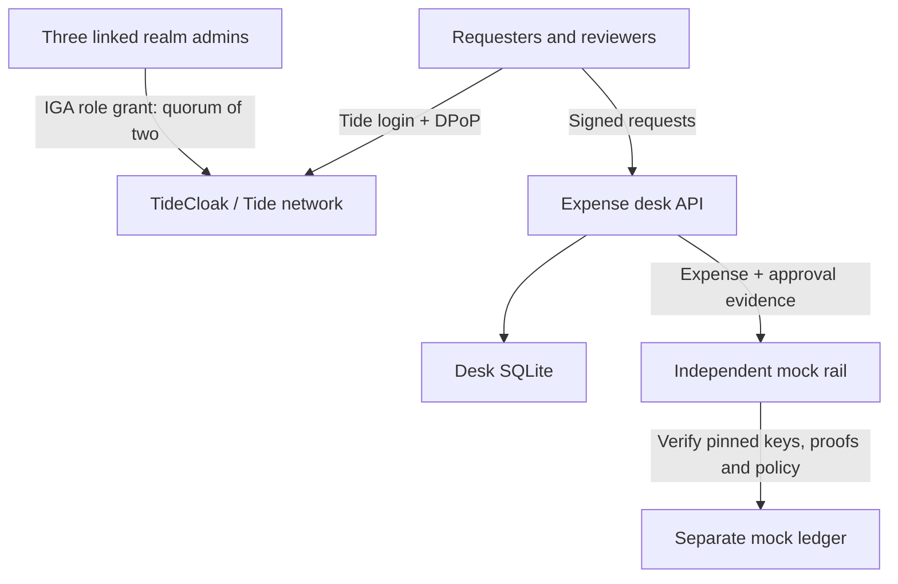

# Security boundaries and architecture

## The claim this prototype makes

A local finance administrator cannot become an expense reviewer merely by editing an app table. App authority comes from verified Tide-signed token roles. In an appropriately configured IGA realm, granting those roles requires the realm's governance quorum. The app does not provide a role-grant endpoint or hold runtime admin credentials.

An application database writer cannot authorise a payment by fabricating two approval rows. The independent mock rail verifies signed approval evidence and the content digest before writing its own ledger.

These claims depend on the **live acceptance tests**, independent identities, three linked admins, correctly pinned adapters and separate runtime control. This is a prototype with a mock rail, not a claim that any administrator or computer owner is powerless in every deployment.

## Flow and separation

Tide's threshold identity infrastructure and IGA governance are provided by TideCloak. Two-person expense logic and the mock payment verifier are application code. No custom Forseti signing contract is deployed or claimed. Native TideCloak console performs the real role-change ceremony; `/lab` performs no real security operation.

## Approval evidence

1. The server fixes an expense UUID, requester subject and creation timestamp. Payment details cannot be edited through the API.
2. SHA-256 covers a canonical JSON array of ID, title, payee, account, amount, currency, evidence reference, requester and timestamp.
3. Each reviewer posts to `/api/expenses/{id}/{digest}/{lane}` using the SDK's `secureFetch`. Its signed DPoP proof covers the absolute URL, method, token hash and time. Encoding the digest and lane in the path matters because DPoP does **not** bind arbitrary HTTP body bytes.
4. The desk verifies token signature against the exported Tide keys, issuer, authorised client, required subject/expiry/issued-at, maximum age, DPoP key binding, target, method, token hash, proof freshness and replay ID. Realm role checks and requester exclusion run server-side.
5. The independent rail distrusts stored status and subject columns. It repeats the cryptographic checks on the two proofs, derives identities and roles from verified tokens, requires both lanes and two distinct nonrequester subjects, and recomputes the digest.
6. The rail checks evidence again rather than treating it as a new HTTP authentication event. Therefore its evidence validator does not consume the same DPoP replay ID twice. Its own UNIQUE expense and digest constraints enforce payment idempotency. The live desk HTTP authenticator uses a persistent SQLite replay store.

DPoP is a proof of key possession and request construction; it is **not** a hardware-backed, human-readable payment consent signature. A malicious frontend can mislead an already logged-in user. A production high-assurance design should use an independently reviewed transaction-consent ceremony or governed signing contract, not relabel DPoP as one.

## Protected and unprotected surfaces

| Surface                                 | Enforcement                                                                                                   |
| --------------------------------------- | ------------------------------------------------------------------------------------------------------------- |
| `/api/expenses`                         | Signed Tide JWT + DPoP; realm roles; requester sees only own expenses unless also a reviewer/auditor/executor |
| Expense approval                        | Correct reviewer realm role, no self-approval, one identity per expense, immutable digest                     |
| Expense execution                       | Executor realm role on desk; independent rail requires both valid operation-bound approvals                   |
| `/api/audit`                            | Auditor, reviewer or executor realm role                                                                      |
| `/api/me`                               | Signed Tide JWT + DPoP                                                                                        |
| `/api/config`                           | Public adapter verification metadata, no secret credentials                                                   |
| `/api/health`, `/`, `/lab`, relay files | Public; no protected financial state                                                                          |
| Real role assignment                    | TideCloak IGA, outside the application's own database                                                         |

The rail allows a valid pair of approval proofs to authorise their exact payment; its transport is local/network-private in this demo. The app's executor role gates the UI/API trigger, while the two reviewers' evidence is the independent rail's actual payment authority. It does not independently authenticate the executor.

## Revocation and freshness

- Revocation is prospective; it cannot recall copied data or reverse a completed mock payment.
- A committed role revocation does not instantly invalidate a previously issued offline-verifiable JWT. Set realm token lifespan to 120 seconds; the verifier additionally rejects token age over five minutes. Access expires at the earlier limit.
- A stored approval can be used only before the access token expires, before token age exceeds five minutes and while the DPoP proof is within the five-minute time window. Renew both approvals if needed. The UI's recorded approval count is not a claim that they are currently executable.
- The application does not query TideCloak on every payment for live role state. Do not claim immediate role revocation.

## Operational assumptions and limits

- Local development places app, rail and files on one laptop. For a server-compromise demonstration, run the rail under a separate administrator/account and give it a separately pinned read-only adapter. A local root user who can replace every binary and public key is outside this model.
- Bootstrap trusts the initial operator; test only after enrolling three independent admins and committing all initial grants. Do not use master tokens to demonstrate governed actions. Master-realm credentials have exceptional bootstrap authority and must not be held by the app.
- A malicious app host can deny service, edit the UI, delete records and change its own audit. The independent rail should reject fabricated or modified approval evidence while its own code, keys and ledger remain trustworthy.
- App SQLite and audit are persistent, but the audit is not an externally anchored, append-only cryptographic log. Tokens and DPoP proofs in the desk database are sensitive, short-lived authorisation artifacts; keep the database private and out of GitHub.
- No E2EE is claimed for invoices. Evidence is a synthetic reference string; there are no real records or document upload/fetch features.
- No real banking connection, payment settlement, production rate-limit, HA deployment or independent penetration test is included. The build targets a local hackathon demo.
- Browser sessions must be separate and real people must control the relevant identities. One person controlling all three admin accounts defeats the organisational independence claim.

## Official integration provenance

The SDK provider, auth callback, DPoP relay, Next.js wiring and core JWT/DPoP helpers started from the official Tide Agent Pack v1.9.33 `nextjs-customer-portal` template. Changes add required JWT claims and maximum age, a persistent HTTP replay store, trusted fixed public origin, application rules and a safe non-destructive bootstrap. Current IGA guidance was read from `iga-admin-governance` and `setup-iga-admin-panel`.

Tide's pack contains some conflicting older IGA endpoint descriptions; runtime governance in this project deliberately uses the bundled native console and its current `/iga/change-requests/{id}/approve` enclave ceremony, rather than implementing a guessed custom admin proxy.
